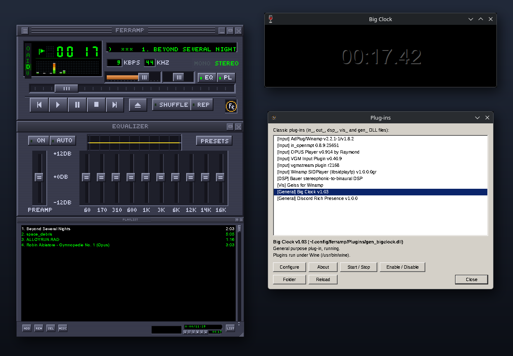
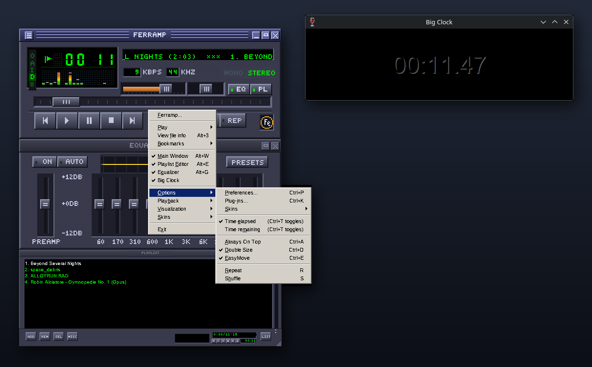

# Ferramp

A cross-platform audio player in Rust that recreates the look and feel
of the classic Winamp 2 player: main window, graphical equalizer and
playlist editor, docked together. It runs on Linux, Windows and macOS.
Every line of code and every pixel of the built-in skin was written from
scratch, so the built-in skin is Ferramp's own and not the original
artwork. Ferramp is free software (MIT or Apache-2.0).

Load any classic Winamp 2 `.wsz` skin, including the original base skin
if you have it, and the windows look the way they did in the original,
pixel for pixel.


## What it does

- Main window with time display, scrolling song title, bitrate and
  sample rate, mono/stereo, spectrum analyser and oscilloscope, volume,
  balance, seek bar, transport buttons, shuffle, repeat and the clutter
  bar (options, always on top, file info, double size, visualisation).
- Window-shade mode for all three windows, double size, EasyMove,
  always on top.
- 10-band equalizer with preamp, the response graph, presets
  (built-in library, auto-load presets per file, EQF import and export).
- Playlist editor: resizable in steps, the ADD, REM, SEL, MISC and LIST
  button menus, multiple selection, drag to reorder, sorting, M3U, M3U8
  and PLS, jump to file, bookmarks, HTML export.
- Windows dock to each other and snap to screen edges; moving the main
  window moves the docked group.
- MP3, MP2, Ogg Vorbis, FLAC, WAV, AIFF, AAC/M4A, ALAC, CAF and Matroska
  audio (Symphonia), internet radio over HTTP(S) with stream titles.
- Classic skins: `.wsz`/`.zip` or folders, `viscolor.txt`,
  `pledit.txt`, `region.txt` (shaped windows) and skin cursors.
- Classic plug-ins: input, output, DSP, visualization and general
  purpose DLLs, on Windows natively and on Linux and macOS through Wine
  (see Plug-ins below).
- The classic menus, keyboard shortcuts and tooltips.

## Download

Ready-made builds for Windows, macOS (universal) and Linux (x86_64 and
ARM64) are on the [releases page](https://github.com/SpankulatorX/ferramp/releases/latest).
None of them is code-signed: on Windows SmartScreen may ask you to
confirm, and on macOS you right-click the app and choose Open the first
time.

One-liner for Linux (picks the .deb, .rpm or tarball for you and checks
it against the release checksums):

```sh
curl -fsSL https://raw.githubusercontent.com/SpankulatorX/ferramp/main/install.sh | sh
```

| Distro | Install |
| --- | --- |
| Debian / Ubuntu | Download `ferramp-<version>-linux-amd64.deb` (ARM64: `-arm64.deb`) and `sudo apt install ./ferramp-*.deb` |
| Fedora / RHEL / openSUSE | Download `ferramp-<version>-linux-x86_64.rpm` (ARM64: `-aarch64.rpm`) and `sudo dnf install ./ferramp-*.rpm` (openSUSE: `sudo zypper install --allow-unsigned-rpm ./ferramp-*.rpm`) |
| Arch | `makepkg -si` in `packaging/aur/ferramp-bin` (or `packaging/aur/ferramp` to build from source) |
| Anything else | Download `Ferramp-<version>-linux-<arch>.AppImage`, `chmod +x` it and run it, or unpack the `.tar.gz` and run `./install.sh` for a `~/.local` install with a menu entry |

Linux needs ALSA (or PipeWire/Pulse with the ALSA plug-in), an X11 or
XWayland display and glibc 2.35 or newer (Ubuntu 22.04, Debian 12,
Fedora 36 or later).

## Building

```sh
cargo build --release
./target/release/ferramp [files, folders, playlists or URLs]
```

Linux needs the ALSA development files (`alsa-lib`) and an X11 or
XWayland display. On Wayland desktops Ferramp uses XWayland, because the
docked borderless windows must be positioned freely; `FERRAMP_WAYLAND=1`
selects native Wayland, where the window manager places the windows.

To cross-check a build without a C compiler for the target, disable the
TLS feature: `cargo check --no-default-features --target x86_64-pc-windows-gnu`.

## Skins

Put `.wsz` files in the skins folder (`~/.config/ferramp/Skins` on Linux,
`%APPDATA%\ferramp\Skins` on Windows, `~/Library/Application Support/ferramp/Skins`
on macOS) or use *Skins > Skin Browser* (Alt+S). The browser also lists
the Skins folder of an existing classic player installation (Windows or
Wine). Missing bitmaps fall back to the built-in skin, the way classic
skins always worked.

*Skins > Get more skins!* (also a button in the Skin Browser) opens the
Winamp Skin Museum (skins.webamp.org) inside Ferramp: browse its most
loved skins or search its 100,000, see a preview, and download one with a
click. Each skin belongs to its author; Ferramp only fetches the one you
pick and checks that it loads before saving it in the skins folder.

The original base skin is not ours to ship. On first start Ferramp offers
to download it from the Internet Archive
(archive.org/details/winampskin_base_2_91), shows it next to the built-in
skin, and checks the download against a fixed SHA-256 before using it. The
same offer is under *Skins > Classic Look*.

## Plug-ins

Ferramp loads classic Winamp 2 and 5 plug-ins: input (`in_*.dll`, for
formats such as Opus, tracker modules, SID, VGM and game audio), output
(`out_*.dll`), DSP and effects (`dsp_*.dll`), visualization
(`vis_*.dll`) and general purpose (`gen_*.dll`).



- Put the DLL files in the `Plugins` folder inside the configuration
  folder (`~/.config/ferramp/Plugins` on Linux, `%APPDATA%\ferramp\Plugins`
  on Windows, `~/Library/Application Support/ferramp/Plugins` on macOS).
  Libraries a plug-in needs go one folder up, where the original
  player's program file would be.
- *Options > Plug-ins* (Ctrl+K) lists them. Configure and About open the
  plug-in's own windows; Start / Stop switches the active DSP,
  visualization or output plug-in; Enable / Disable decides whether it
  loads at all. Ctrl+Shift+K starts and stops the chosen visualization.
- Input plug-ins play the formats Ferramp has no decoder for, and act as
  a fallback when the built-in decoder cannot read a file. They also
  supply titles and durations for the playlist.
- General purpose plug-ins see the player state and playlist and can
  control playback, as they did in the original player. Items they add
  to the player's menu (such as Big Clock's show and hide) appear in
  Ferramp's main menu, below the window toggles. Their own windows,
  analyzer data and the later service layer some of them use (language,
  memory and application services) are provided too.
- Plug-ins run in a separate program, `ferramp-plughost`, which ships
  with Ferramp. It is a Windows program: Windows runs it directly, Linux
  and macOS run it under Wine (`apt install wine`, `dnf install wine`,
  `pacman -S wine`, or `brew install --cask wine-stable`). A plug-in that
  crashes or hangs only takes the helper down; Ferramp restarts it, and
  a plug-in that hangs or crashes while loading is left out and marked
  in the list. A plug-in that shows a dialog while loading is given time
  for you to answer it. When a plug-in cannot load because a library it
  needs is missing, the list names that library.



Tested so far, under Wine on Linux: files played through `in_opus`,
`in_openmpt`, `in_vgm`, `in_sidplay2` and `in_adlib`; `dsp_bs2b` and
`dsp_qat` started and configured; `gen_bigclock` shown, following
playback and toggled from Ferramp's menu; `in_vgmstream`, `in_msx`,
`in_mad`, `out_wave_gpl`, `out_yasapi-nt`, `vis_geis`, `vis_plainbar` and
`gen_discord_rpc` loaded. Plug-ins built only for WACUP (such as its
`gen_win7shell`) do not load. Every plug-in kind is also tested end to
end against Ferramp's own test plug-ins, on Windows and under Wine.

## Keyboard

| Key | Action |
| --- | --- |
| Z X C V B | Previous, Play, Pause, Stop, Next |
| Shift+V, Ctrl+V | Stop with fade-out, stop after current |
| Left, Right | Back / forward 5 seconds |
| Up, Down | Volume |
| L, Ctrl+L, Shift+L | Open file, location, folder |
| J, Ctrl+J | Jump to file, jump to time |
| R, S | Repeat, shuffle |
| Ctrl+T, Ctrl+D, Ctrl+A, Ctrl+E | Time mode, double size, always on top, EasyMove |
| Alt+W, Alt+E, Alt+G | Main window, playlist editor, equalizer |
| Alt+3, Alt+S, Ctrl+P | File info, skin browser, preferences |
| Alt+I, Ctrl+Alt+I | Add bookmark, edit bookmarks |
| Numpad 0-9 | The classic numpad bindings |

## Options

`ferramp --render DIR [--skin FILE] [files]` renders every window to PNG
files without opening a window. `FERRAMP_SCALE=2` doubles everything on
very high-resolution screens. Settings are kept in `ferramp.ini` in the
configuration folder (`FERRAMP_CONFIG_DIR` overrides it).

## Limitations

- Without plug-ins, Opus, WavPack, tracker modules and MIDI cannot be
  played (Symphonia has no decoder for them).
- Plug-ins that depend on the later player's internal service layer
  (Wasabi), such as the media library and some plug-ins bundled with the
  original player, do not start.
- The equalizer graph follows the original curve closely but not to the
  last pixel.
- Native Wayland mode cannot dock or snap windows, since Wayland does not
  let applications position their own windows.
- The media library, minibrowser and video window are not part of this
  recreation.

## Licence

MIT or Apache-2.0, at your option. See `NOTICE` for third-party credits.

Ferramp is an independent project. It is not affiliated with or endorsed
by Winamp or its owners, and it contains none of their code or artwork.
"Winamp" is a trademark of its respective owner and is named here only
to say which skins Ferramp can load.
